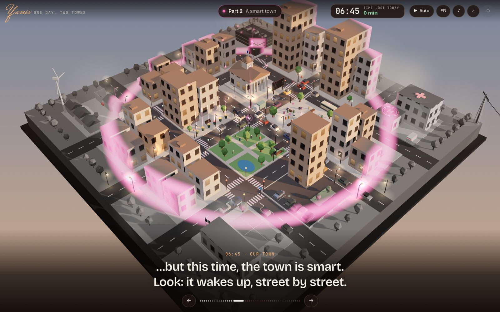
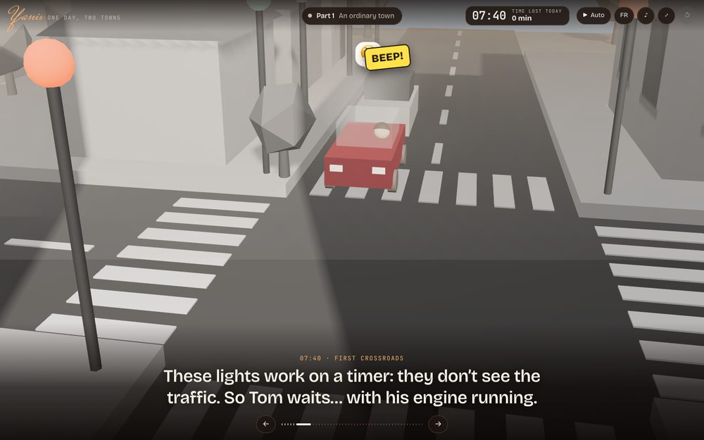
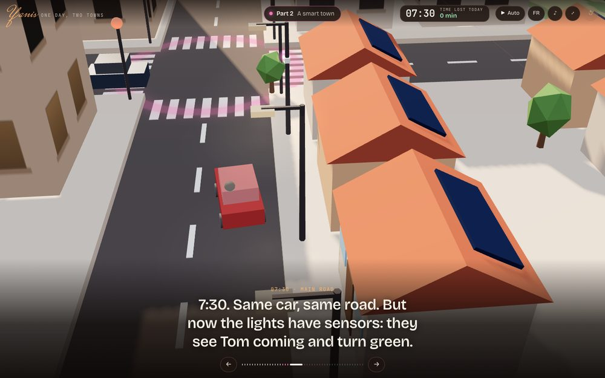
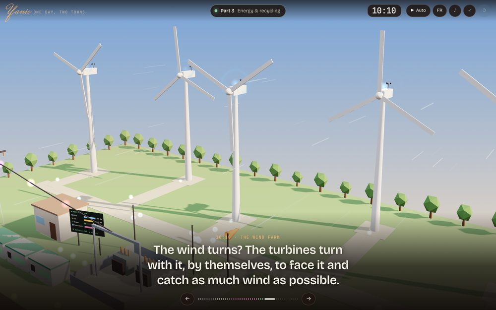
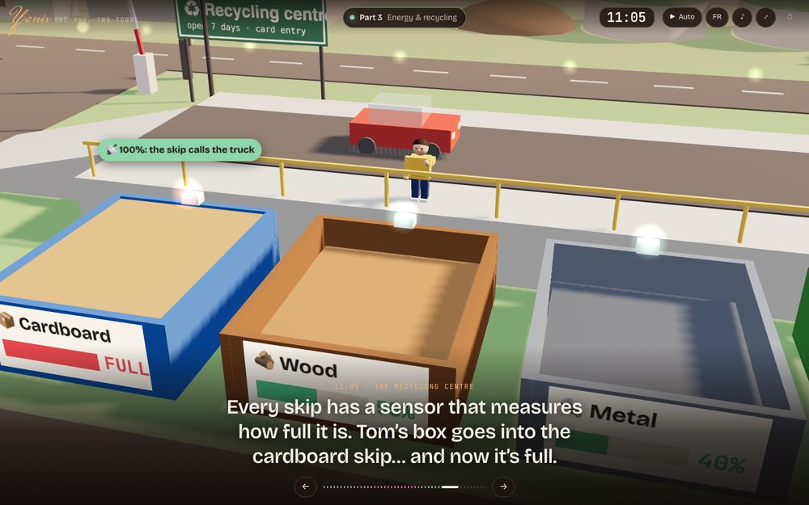
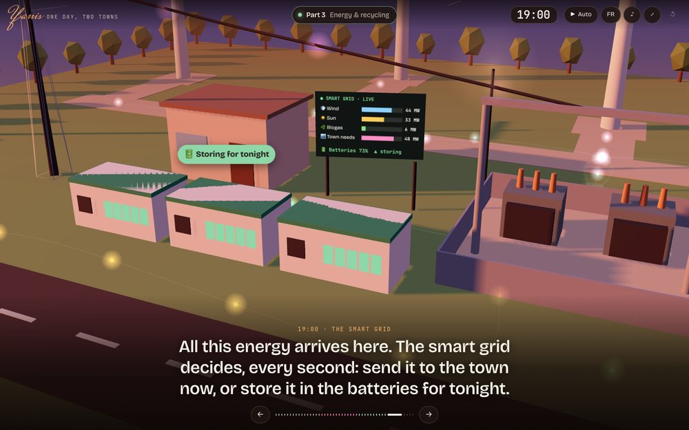
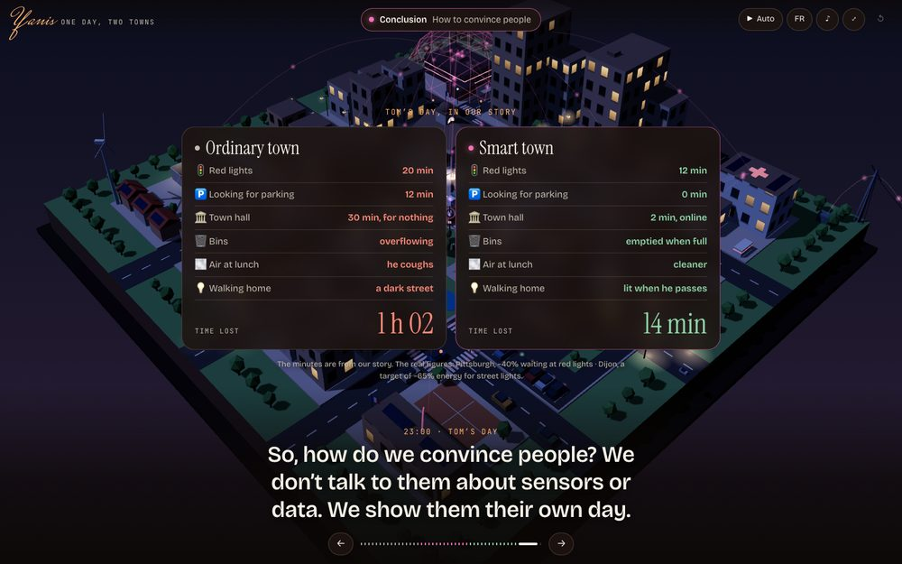
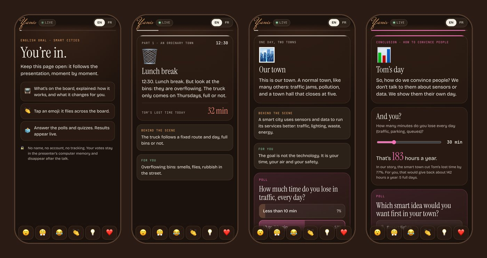
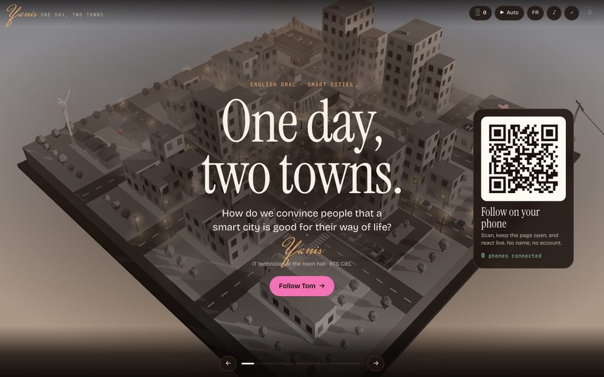

<div align="center">



# One Day, Two Towns

**Un film 3D interactif pour convaincre qu'une smart city change la vie,<br>la même journée vécue deux fois, et le public qui suit sur son téléphone.**

*Oral d'anglais · BTS CIEL · « How to convince people this is beneficial for their way of life? »*

<br>


[L'histoire](#-lhistoire) · [Lancer](#-lancer) · [Le public en direct](#-le-public-en-direct) · [Pendant l'oral](#%EF%B8%8F-pendant-loral) · [Les chiffres](#-les-chiffres) · [Comment c'est fait](#-comment-cest-fait)

</div>

<br>

## 🎬 L'histoire

On suit **Tom**, du réveil au coucher. Deux fois.

<table>
  <tr>
    <th width="50%">😤 Partie 1 : la ville ordinaire</th>
    <th width="50%">✨ Partie 2 : la smart city</th>
  </tr>
  <tr>
    <td></td>
    <td></td>
  </tr>
  <tr>
    <td>Maison froide au réveil, feux rouges pour rien, tours de pâté de maisons pour se garer, poubelles qui débordent, air pollué, mairie fermée, rue sombre au lampadaire cassé.<br><br><b>Temps perdu : 1 h 02</b></td>
    <td>Chauffage intelligent, feux qui voient les voitures, place indiquée par l'appli, bennes vidées quand elles sont pleines, démarches en ligne, lampadaires qui s'allument au passage. Le capteur compte sans filmer (RGPD).<br><br><b>Temps perdu : 14 min</b></td>
  </tr>
</table>

Entre les deux, **on rembobine** : la journée repart en arrière, puis une onde rose réveille la ville rue après rue (l'image tout en haut).

### ⚡ Partie 3 : l'énergie et les déchets

On suit la ligne électrique jusqu'à une **deuxième carte**, une île juste à côté de la ville. Ici, que le côté positif : comment c'est smart.

<table>
  <tr>
    <td width="33%"></td>
    <td width="33%"></td>
    <td width="33%"></td>
  </tr>
  <tr>
    <td><b>🌬️ Parc éolien</b><br>Des capteurs mesurent le vent chaque seconde, les éoliennes se tournent seules, une pièce usée est signalée avant la panne.</td>
    <td><b>♻️ Déchèterie</b><br>La carte d'habitant ouvre la barrière, chaque benne mesure son remplissage et appelle le camion quand elle est pleine.</td>
    <td><b>🔋 Réseau intelligent</b><br>Vent, soleil et biogaz en direct. Le jour, les batteries se chargent ; la nuit, elles rendent l'énergie à la ville.</td>
  </tr>
</table>

Sans oublier le **méthaniseur** (déchets verts → gaz → électricité, et du compost) et le **parc solaire** dont les panneaux suivent le soleil.

### 📊 Conclusion



Les deux journées côte à côte, puis la réponse : *on ne parle pas aux gens de capteurs ou de données, on leur montre leur propre journée.*

> 💬 En bas de l'écran, le sous-titre est **exactement ce qu'on dit à l'oral**, en anglais (`T` ajoute la traduction pour répéter). Tom réagit avec des bulles (😤, *BEEP!*, *cough!*) et son téléphone reçoit des notifications.

<br>

## 🚀 Lancer

**Juste la présentation :** double-clic sur `index.html` (Chrome conseillé). Rien à installer, tout marche hors ligne ; seules les polices viennent de Google Fonts.

**Avec le public en direct :**

```bash
npm start
```

Node 18 ou plus, **aucune dépendance**. Le tableau s'ouvre sur `http://localhost:8080` et le terminal affiche le QR code des téléphones.

> [!NOTE]
> L'ordinateur et les téléphones doivent être sur le **même Wi-Fi**. Au premier lancement, macOS demande d'autoriser `node` à recevoir des connexions : cliquer sur « Autoriser ».

> [!TIP]
> Les téléphones n'arrivent pas à se connecter ? Le Wi-Fi de l'école isole sûrement les appareils. Activer le **partage de connexion** d'un téléphone, y mettre l'ordinateur et le public, puis relancer `npm start`. Pour changer de port : `PORT=8081 npm start`.

<br>

## 📱 Le public en direct



Le public scanne le QR code de l'écran titre et suit l'oral **moment par moment** sur son téléphone :

| | |
| --- | --- |
| 🎞️ **Le moment** | la phrase dite, l'heure, le lieu et le temps perdu par Tom |
| 🔧 **Behind the scene** | comment ça marche, techniquement |
| 🙋 **For you** | ce que ça change dans la vie de tous les jours |
| 🗳️ **5 sondages + 2 quiz** | les résultats s'affichent en direct au tableau, la bonne réponse est révélée au moment suivant |
| 😮 **6 emojis** | ils s'envolent sur le côté du tableau |
| 🧮 **And you?** | à la fin, chacun calcule le temps qu'il perd par an |
| 📳 **Vibrations** | courtes et rares : nouveau sondage, vote, quelques moments clés (Android ; sur iPhone, un petit clic au toucher) |

<details>
<summary><b>Plus de détails</b></summary>

<br>



- **Au tableau** : le QR code est sur l'écran titre ; ensuite `Q` (ou le bouton 📱, qui compte les téléphones connectés) l'affiche en grand. Les résultats des sondages apparaissent en haut à gauche pendant le moment concerné (`V` pour les masquer).
- **Langue** : la page est en anglais quelle que soit la langue du téléphone ; un bouton FR permet la traduction.
- **Recommencer** : revenir à l'écran titre (bouton discret ↺ en haut à droite, touche `Début`, ou rechargement sur l'écran titre) **vide les sondages, déconnecte tous les téléphones** (ils affichent *Session over*) **et crée un nouveau QR code**. L'ancien lien ne marche plus.
- **Vibrations** : jamais deux vibrations automatiques à moins de 2 s, et aucune si « réduire les animations » est activé. Les moments qui vibrent : les deux réveils, le bouchon, le retour en arrière, l'onde, la déchèterie, la fin.
- **Vie privée** : pas de nom, pas de compte, pas de suivi. Les votes restent dans la mémoire du serveur et disparaissent quand on l'arrête. Seul l'ordinateur qui présente peut changer de moment.

</details>

<br>

## 🎙️ Pendant l'oral

| Touche | Action |
| :---: | --- |
| `→` `Espace` ou clic | moment suivant (marche avec une télécommande de présentation) |
| `←` | moment précédent |
| `R` | rejouer le moment affiché |
| `T` | traduction française sous la phrase (pour répéter) |
| `P` | lecture automatique (pour répéter seul) |
| `M` | son : réveil, klaxon, toux, notifications |
| `F` | plein écran |
| `Début` / `Fin` | premier / dernier moment |
| `Q` | QR code en grand |
| `V` | masquer / afficher les résultats de sondage |

On peut ouvrir directement un moment : `index.html#18`. La partie 3 commence à `#30`, la conclusion à `#43`.
La souris fait tourner la caméra (glisser) et zoome (molette) ; le moment suivant remet le bon cadrage.

<br>

## 📐 Les chiffres

Les minutes perdues par Tom (1 h 02 et 14 min), comme les mégawatts et les pourcentages de la partie 3, viennent **de notre histoire**. Les deux chiffres réels sont cités avec leur source à l'écran :

- 🚦 **Pittsburgh** : environ **−40 %** d'attente aux feux rouges avec les feux Surtrac. Chiffres donnés par l'équipe de Carnegie Mellon pour le premier pilote.
- 💡 **Dijon** : un objectif de **−65 %** d'énergie pour l'éclairage, inscrit au contrat OnDijon (2017). C'est un objectif, pas un résultat mesuré.

<br>

## 🧱 Comment c'est fait

Pas de framework, pas de build : du HTML, du CSS et du JavaScript, avec Three.js pour la 3D.

```
smart-city/
├── index.html        la page : écran titre, tableau final, conclusion
├── css/style.css     le style (polices, couleurs, verre), sous-titres et bulles
├── js/
│   ├── city.js       la ville en Three.js et les 44 moments de l'histoire (tableau B)
│   ├── live.js       la partie live du tableau : QR, compteur, réactions, résultats
│   ├── qr.js         un générateur de QR code fait maison (aucun internet nécessaire)
│   └── polls.js      les sondages, les quiz et le moment où chacun s'ouvre
├── phone/            la page des téléphones (content.js : « Behind the scene » et « For you »)
├── server.js         le serveur local : fichiers, direct par Server-Sent Events, votes, réactions
├── vendor/           Three.js r128
└── docs/             les images de ce README
```

- **`city.js`** contient tout le monde 3D : la ville, la maison de Tom, Tom et ses poses, sa voiture, le parking, l'île de l'énergie (éoliennes, panneaux sur trackers, batteries, méthaniseur, déchèterie, camion), l'onde ordinaire → smart, l'heure du jour et la simulation (feux, voitures, bus, camion poubelle, lampadaires).
- **Le direct** passe par des *Server-Sent Events* : le tableau envoie chaque moment au serveur, qui le relaie à tous les téléphones.
- **Le QR code** est généré sans bibliothèque (versions 1 à 10, correction M), dans la page comme dans le terminal.

> ✏️ Pour changer une phrase, modifier `cap` (anglais) ou `fr` (français) dans le tableau `B` de `js/city.js`.

<br>

<div align="center">
<sub>Fait par <a href="https://yanis.pro">Yanis</a> · BTS CIEL</sub>
</div>
